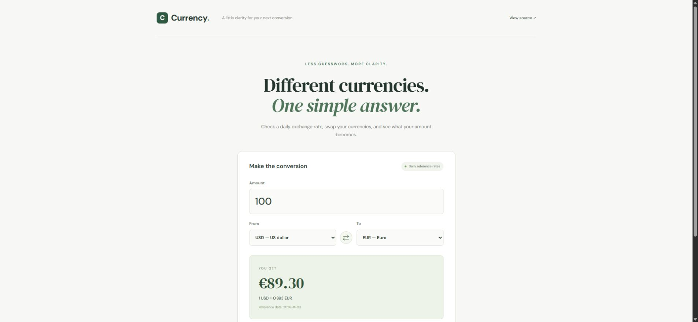

# Currency

A focused currency converter built with React. Pick two currencies, enter an amount, and see the conversion using the latest daily reference rate.



Currency converter showing a real daily reference rate.

## What problem did I solve?

I wanted a quick way to understand an amount in another currency without working out the conversion myself. The interface keeps the amount, currency pair, result, and rate date together, so the number has context.

## What the app does

- Converts between USD, EUR, BRL, GBP, CAD, AUD, JPY, CHF, CNY, and INR.
- Updates the result as the amount changes without requesting the same rate again.
- Swaps the selected currencies and handles same-currency conversions locally.
- Shows loading, invalid-input, and network-error states with a retry action.
- Uses the free [Frankfurter v2 API](https://frankfurter.dev/), with no API key.

## How do I know my solution works?

Five automated tests check conversion arithmetic, zero and invalid amounts, swapping currencies, the same-currency case, and recovery after a failed request. The tests mock the provider so they are repeatable. The production build also passes.

GitHub Actions runs these checks on pushes and pull requests. A passing test suite checks the app's behavior; it does not guarantee that the external rate provider is always available.

## Run locally

Requires Node.js 22 and npm.

```bash
npm ci
npm start
```

Open http://localhost:3000.

```bash
npm test -- --watchAll=false --runInBand
npm run build
```

The production files are written to `build/`. The configured public path is `/Currency/`; set `PUBLIC_URL=/` when building for a domain root.

## Technical choices and limits

React manages the form and request state. A separate rate client validates HTTP responses and rate values. Requests are cancelled logically when the selected pair changes, so an older response cannot replace the current result.

These are daily reference rates, not live trading or bank transaction quotes. Fees and spreads are not included. The app does not store personal or transaction data. The project currently uses the legacy Create React App toolchain; migrating the build tooling is a separate maintenance task.
